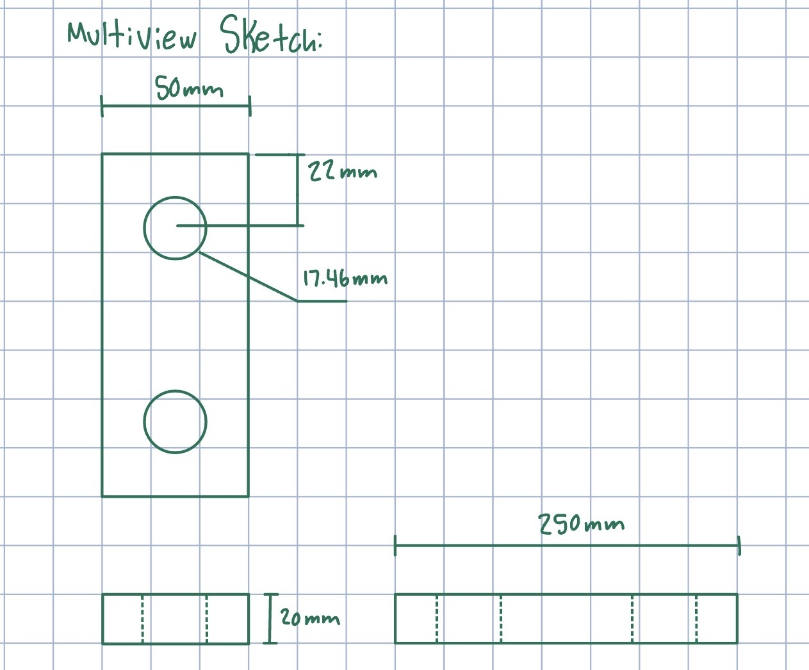
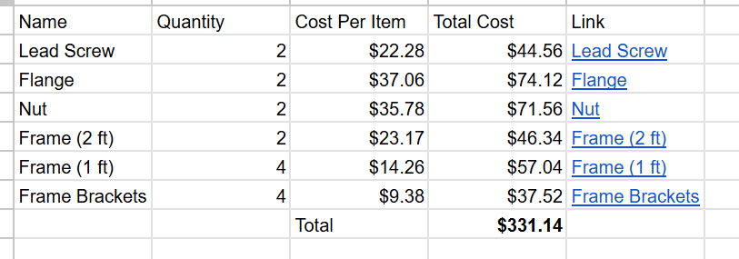
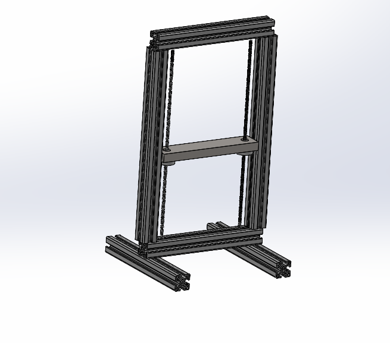

# A10 – Lead Screw Translating System

## CAD Assembly Link

<a href="A10(1).zip" download>Download Truss SolidWorks Assembly (.ZIP)</a>

## Objective

For this assignment we were given the following parameters: 

Design and build a mechanically driven tensile tester capable of applying up to 2 kN axial tensile load with a controllable crosshead speed from 1 to 50 mm/min. Each team is responsible for the mechanical components outlined below. The system will provide consistent, well-aligned loading for polymers and light metals, suitable for instructional use and basic materials evaluation.

This is a Given List of the overall Scope for the project and key constraints we had to adhere by throughout our design process:

## Lead Screw Design

### Lead Screw Minimum Diameter Calculations: (Noah D)

The first step in this assignment is to determine the minimum diameter that the lead screw can be based on axial stress. We chose Carbon Steel as the material for our lead screw, which has a yield strength of 310 MPa. It is also important to take into consideration the safety factor of 4 when performing these calculations. 

### Torque and Speed Calculations: (Noah D)

Next we calculate the rotational speed range given the minimum and maximum torque that can be applied. We used both materials properties to find that 0.4 would be an accurate coefficient of friction in order to consider friction in our calculations. 

### Nut and Flange Calculations: (Noah D)

Next was determining the bearing and bending stress the nut would experience under the given load, and whether the nut we chose could withstand the forces being put into it. It is also important to consider the safety factor of 4 in these equations. 

## Crosshead Design 

I began creating a relevant FBD and listing my knowns and unknowns. I began picking a strong, readily available material and quickly settled on A36 steel. I researched the Yield strength and Young’s modulus and added them to my list of known values. I Used the chosen flange thickness from my partner to set a baseline width, and used our tabletop footprint to select a length. I chose a 50mm base and a 250mm length for the crosshead. I then modeled the equations relevant to stress and deflection, and solved for my allowable height. I plugged in my chosen and given values and I saw that my limiting factor was deflection. At 19.84mm of required height, this value was very close to 20mm which was the height I chose.

### Designing Crosshead (Exie D)

### Beam Stress Analysis (Exie D)

### Beam Deflection Analysis (Exie D)

## Multiview Sketch (Noah D)

## Bill of Materials: (Noah D)

[Lead Screw](https://www.mcmaster.com/99030A981/)

[Flange](https://www.mcmaster.com/95082A641/)

[Nut](https://www.mcmaster.com/95072A881/)

[Frame (2 ft)](https://www.mcmaster.com/4658N41-4658N43/)

[Frame (1 ft)](https://www.mcmaster.com/4658N41-4658N42/)

[Frame Brackets](https://www.mcmaster.com/47065T845/)

Keep in mind the crosshead is not included in the bill of materials since it is a self fabricated part. 

## Parametric Modeling (Exie D)

Parametric equations will allow for further adjustments if necessary. 

These are the dimensions for our Crosshead. 

Adding in parts from BOM from Mcmaster-Carr. 

Finally adding the outer frame of the assembly.

## Lessons Learned

From this assignment I learned how the overall Design process goes and how one parts constraints impact how other parts are designed. Such as the diameter of the lead screw impacting the force that the other connected components could reliably handle before reaching yield. 

Our group spend around 5 hours on this assignment. 

